# AVAWars

A recreation of Atari's 1983 vector arcade game **Star Wars**, built with .NET 10 and Avalonia UI. Fly the
attack on the Death Star from the cockpit: dogfight TIE fighters in space, skim the surface over laser
bunkers and towers, then dive into the trench, get past Darth Vader's TIE, and put a proton torpedo down
the exhaust port before getting clear as the Death Star explodes. Then do it again, faster.

## Features

- **The whole attack run, in three phases**, as on the cabinet:
  - **Space**: TIE fighters swoop in, fire and scream past while the Death Star grows ahead. Turn
    toward them; the whole sky wheels round you.
  - **The surface**: skim the Death Star over laser bunkers and, from the second wave, tall laser towers.
    Shoot the guns off every tower for a 50,000 bonus, and don't fly into them.
  - **The trench**: turrets on the walls and floor, catwalks to fly over or under (from wave 2), TIEs, and
    then **Vader's TIE**, which can't be destroyed but can be knocked spinning out of the trench. Then
    the **exhaust port**: one torpedo, on target.
- **The Death Star explodes** in a shower of debris and a racing shockwave ring, and a new wave begins.
- **Fireballs**: everything fires spinning fireballs at you, and every one can be shot down.
- **Six shields, and no more**: each hit costs one, a missed torpedo costs one, and you win one back
  for each Death Star destroyed.
- **Use the Force**: fire nothing in the trench but the torpedo and earn a bonus worth up to 100,000.
- **Colour vector look**: glowing wireframe TIEs, X-wing, towers and turrets; a wireframe Death Star with
  its equatorial trench and superlaser dish; a ruled surface grid and a trench that streams past.
- **Mouse, keyboard or gamepad**: the mouse puts the crosshair where it points, like the cabinet's yoke;
  the keys or a stick steer it instead.
- **Synthesised sound**: laser bolts, screaming TIEs, fireballs, explosions, shield hits and an original
  fanfare, plus **radio chatter** ("Stay on target", "He's spinning out of control!") given the grainy
  sound of an early-80s speech chip.
- **Attract mode**: leave the title screen alone for 20 seconds and a computer pilot flies a silent
  demonstration.
- **Top-ten high-score table** with arcade-style initials entry.
- **Any window size**: the 4:3 screen scales to fit, letterboxed. **Ctrl+S** saves a screenshot.
- **One self-contained executable** per platform: Windows, macOS and Linux on Intel/AMD and ARM.

## Screenshots

| Title screen | TIE fighters | Approaching the Death Star |
|:------------:|:------------:|:--------------------------:|
| 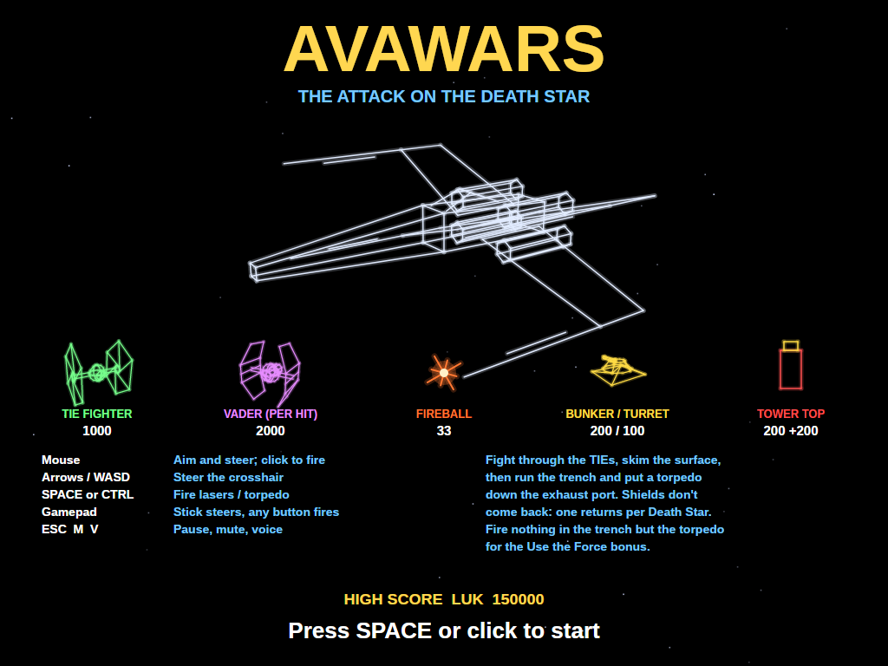 | 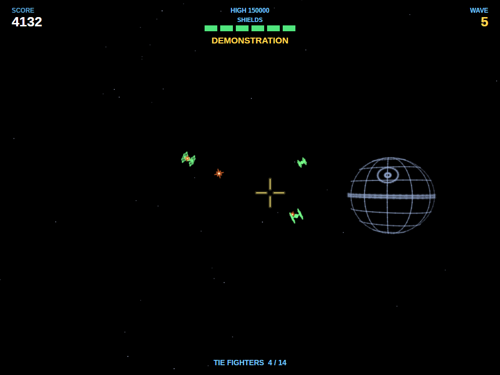 | 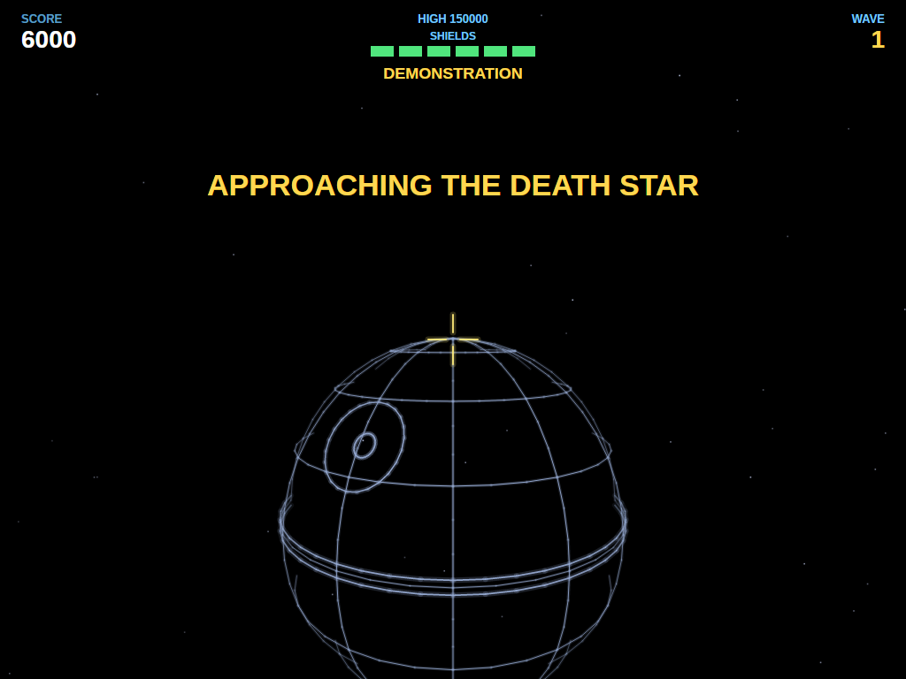 |
| The X-wing turns over the stars, with what everything is worth. | TIEs swoop in firing, with the Death Star off to the right. | The last fighters break off and the Death Star fills the view. |

| The surface | The trench | Vader's TIE |
|:-----------:|:----------:|:-----------:|
| 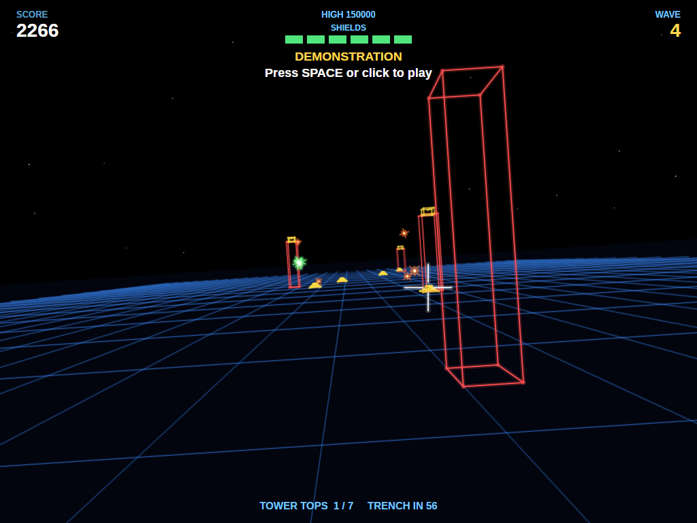 | 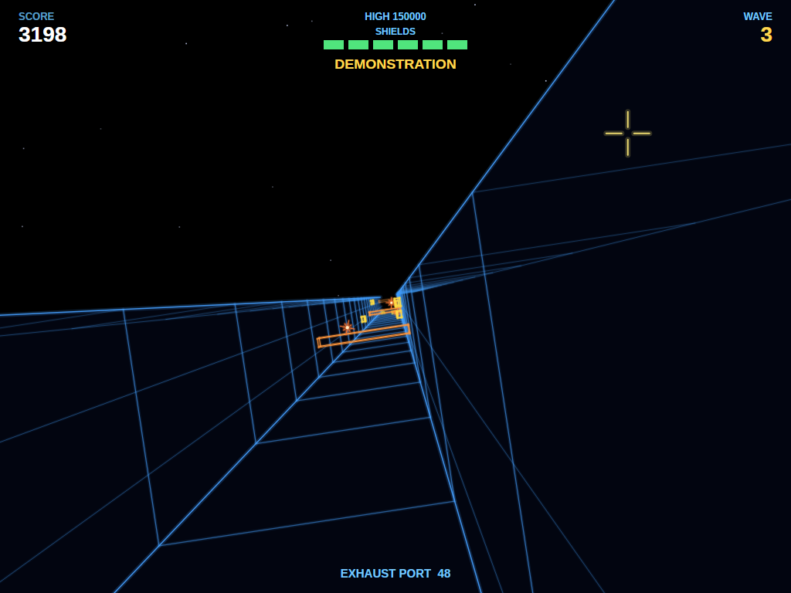 | 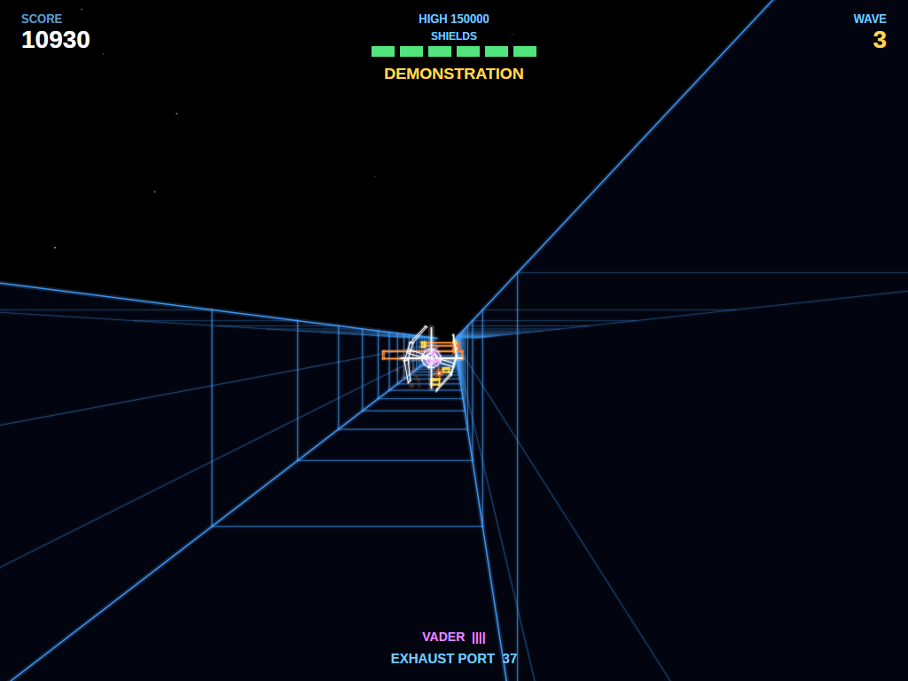 |
| Laser towers and bunkers, with fireballs on the way. | Turrets and catwalks streaming toward you down the trench. | Vader holds ahead of you, weaving and firing. |

| The exhaust port | The Death Star explodes | Attract mode |
|:----------------:|:-----------------------:|:------------:|
| 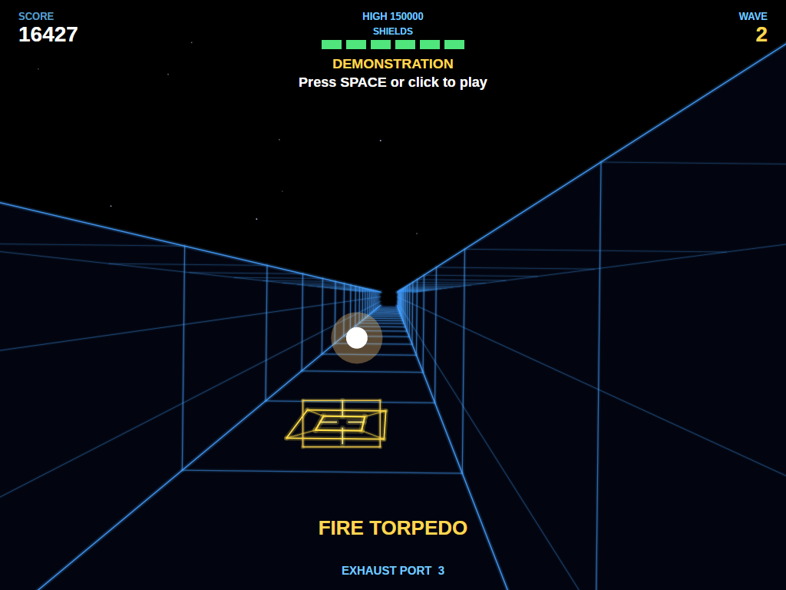 | 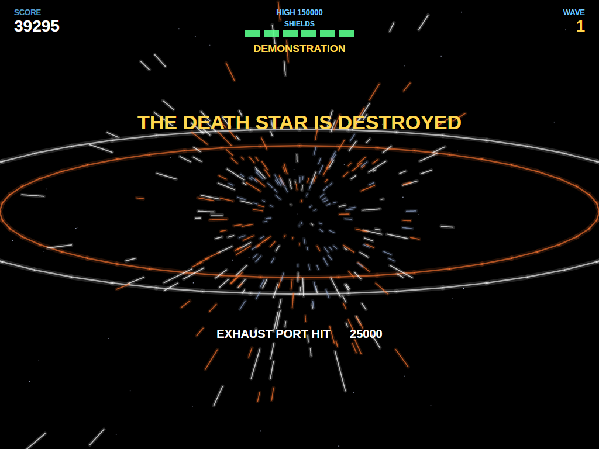 | 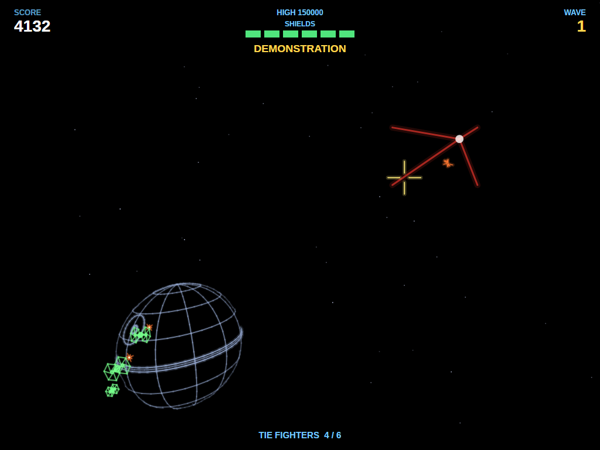 |
| The port in the targeting box, and a torpedo on its way. | The shockwave races out and the bonuses are counted. | Left alone, the game plays itself, silently. |

| Game over | Entering initials | The high-score table |
|:---------:|:-----------------:|:--------------------:|
| 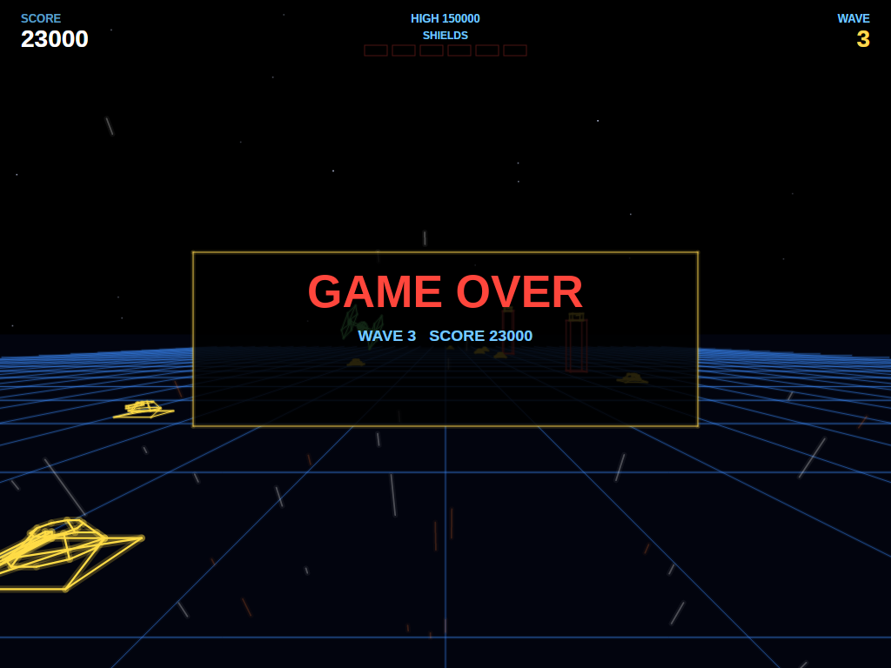 | 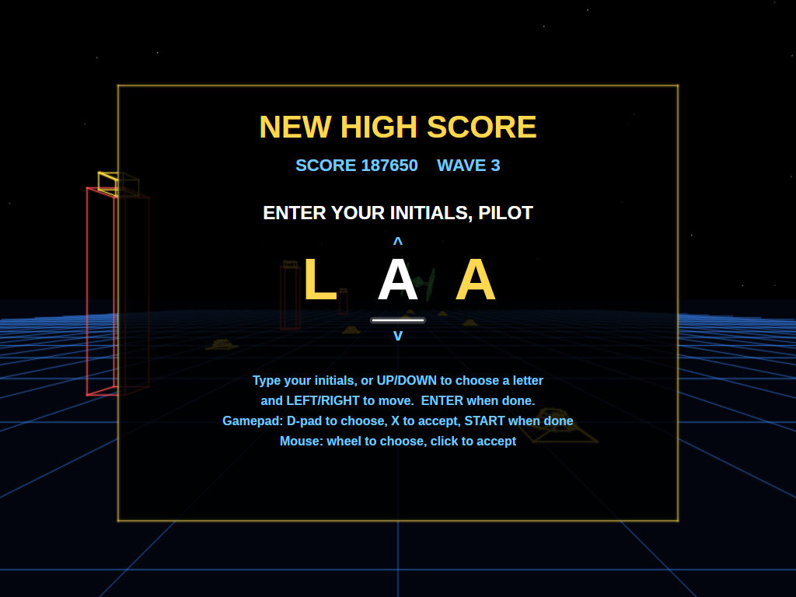 | 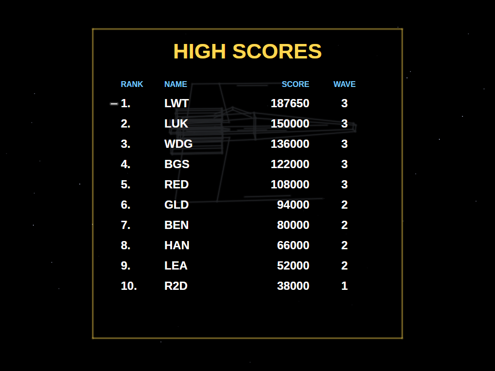 |
| The last shield is gone. | A score that makes the top ten earns three initials. | The new entry flashes in the table. |

## Download and run

Ready-to-run builds for Windows, macOS and Linux, on both Intel/AMD and ARM, are on the
[Releases page](https://github.com/Harlock123/AVAWars/releases). **Latest build** is rebuilt on every
push to `main`. Each download is one self-contained executable: no .NET install is needed.

```bash
tar -xzf AVAWars-linux-arm64.tar.gz     # or linux-x64, linux-arm, osx-arm64, osx-x64
./AVAWars
```

On Windows, unzip `AVAWars-win-x64.zip` (or `-win-arm64`, `-win-x86`) and run `AVAWars.exe`. On macOS,
if Gatekeeper refuses to open it, run `xattr -d com.apple.quarantine AVAWars` once.

### Linux: sound and gamepads

- **Sound** needs `aplay`, from the `alsa-utils` package. Without it the game runs but is
  silent. Minimal installs (Arch, Omarchy, some Raspberry Pi images) don't include it:

  ```bash
  sudo apt install alsa-utils             # Debian / Ubuntu / Raspberry Pi OS
  sudo pacman -S --needed alsa-utils      # Arch / Omarchy
  ```

- **Gamepads** use SDL2. It is bundled for Windows, macOS and Intel/AMD Linux, but **ARM Linux builds need it
  installed**. Without it the keyboard and mouse still work; only the controller does not:

  ```bash
  sudo apt install libsdl2-dev            # Debian / Ubuntu / Raspberry Pi OS
  sudo pacman -S --needed sdl2-compat     # Arch / Omarchy
  ```

  On Debian-based systems it has to be `libsdl2-dev`: the game looks for `libSDL2.so`, which
  the runtime-only `libsdl2-2.0-0` package doesn't provide.

## Requirements

- .NET 10 SDK (to build; the released executables need nothing)
- Windows, macOS or Linux

## Building and Running

```bash
cd AVAWARS
dotnet build
dotnet run
```

## Controls

The cabinet had a flight yoke that moved the crosshair, with fire buttons under the fingers and thumbs.
The crosshair is also how you steer: where it points, the ship goes.

### Mouse

| Input | Action |
|-------|--------|
| **Move** | Put the crosshair there (and steer that way) |
| **Left / Right button** | Fire lasers (hold to keep firing), or a torpedo at the exhaust port |

The pointer is hidden while you fly; the crosshair takes its place.

### Keyboard

| Key | Action |
|-----|--------|
| **Arrows** / **W A S D** | Move the crosshair |
| **Space** / **Ctrl** | Fire lasers, or a torpedo at the exhaust port |
| **Esc** | Pause (Esc again to quit) |
| **M** | Mute all sound |
| **V** | Radio chatter on/off |

### Controller (Xbox/PlayStation/Switch Pro)

| Input | Action |
|-------|--------|
| **Left Stick** / **D-Pad** | Move the crosshair |
| **A**, **B**, **X**, **bumpers**, **triggers** | Fire |
| **Start** | Pause / Resume game |
| **Back/Select** (while paused) | Exit game |

### Entering initials

| Key | Action |
|-----|--------|
| **A**–**Z**, **0**–**9**, **.** | Type a letter and move to the next |
| **Up** / **Down** | Dial the current letter |
| **Left** / **Backspace**, **Right** | Move between letters |
| **Space** | Accept the letter |
| **Enter** | Done |

Gamepad: D-pad dials and moves, **X** accepts, **Start** finishes. Mouse: the wheel dials, a click accepts.

### Other

| Key | Action |
|-----|--------|
| **Ctrl+S** / **Cmd+S** | Save screenshot to Pictures folder |

## Gameplay

### Space

TIE fighters come at you in twos and threes, firing as they close, then scream past. Moving the
crosshair off-centre turns the ship, and the stars, the fighters and the Death Star all swing round.
Destroy enough TIEs (6 in the first wave, more later) and the rest break off as you close on the Death
Star.

### The surface

You skim the surface at speed. The crosshair now slides the ship left and right and up and down. Laser
bunkers fire from the ground; from the second wave, laser towers stand in your path. Shoot the gun off
the top of a tower for 200 points, rising by 200 for each one after; get every tower top in the wave
for a 50,000 bonus. Fly into a tower and it costs a shield.

### The trench

Inside the trench you can't climb out. Turrets on the walls and floor fire at you; from the second wave
catwalks cross the trench and must be flown over or under. TIEs come down the trench at you, and halfway
along **Vader's TIE** appears ahead, weaving and firing. He can't be destroyed, but each hit is worth
2,000 points, and enough of them send him spinning out of the trench.

Near the end, the **exhaust port** appears in a targeting box and the guns switch to proton torpedoes.
Put the crosshair on the port and fire. A hit is worth 25,000 and destroys the Death Star. A miss costs a
shield and you go round for another run.

**Use the Force**: if you fire nothing in the trench but the torpedo, you earn a bonus: 5,000 in the
first wave, then 10,000, 25,000, 50,000, and 100,000 from the fifth wave on.

### Waves and shields

You start with six shields. Every hit by a fireball, a tower or a catwalk costs one, and so does a missed
torpedo; when the last one goes, the game is over. Each Death Star destroyed gives one back (up to six).
Every wave the TIEs fly faster and fire more often, the guns fire faster, the trench gets longer and
Vader takes more hits to shake off.

## Scoring

| Target | Points |
|--------|--------|
| Fireball | 33 |
| Trench turret | 100 |
| Laser bunker | 200 |
| Tower top | 200, then 400, 600... in each wave |
| All tower tops in a wave | 50,000 bonus |
| TIE fighter | 1,000 |
| Vader's TIE | 2,000 per hit |
| Exhaust port | 25,000 |
| Use the Force | 5,000 to 100,000 |

## Sound Effects

All effects are synthesised by `tools/make_sounds.py`; nothing is sampled from the arcade machine or the
film, and the fanfare is an original figure, not the film's music. The radio chatter is made by
`tools/make_voice.sh` with the [Piper](https://github.com/rhasspy/piper) text-to-speech engine and
roughened by `tools/crunch_voice.py` into the gritty sound of a 1983 speech chip.

| Sound | When |
|-------|------|
| `Laser.wav` | The X-wing's cannons |
| `TieScream.wav` / `VaderScream.wav` | A TIE, or Vader's TIE, screaming past |
| `Fireball.wav` / `FireballBoom.wav` | A fireball fired / shot down |
| `ShieldHit.wav` | A hit on the shields |
| `TieBoom.wav`, `GroundBoom.wav`, `TowerBoom.wav` | Things blowing up |
| `VaderHit.wav` | A hit on Vader's TIE |
| `Torpedo.wav` | A proton torpedo |
| `DeathStarBoom.wav` | The Death Star, and the end of the game |
| `Bonus.wav`, `Miss.wav`, `Alarm.wav`, `PhaseStart.wav` | Bonuses, a miss, shields low, a new phase |
| `Fanfare.wav` | The start of a game |
| `Engine.wav` | The X-wing's engines (loops while flying) |
| `Voice*.wav` | The radio chatter |

## Project Structure

```
AVAWARS/
├── AVAWars.csproj, AVAWars.slnx
├── Program.cs, App.axaml(.cs), MainWindow.axaml(.cs)
├── Engine/
│   ├── GameEngine.cs          # States, guns and targets, fireballs, shields, scoring, TIEs
│   ├── GameEngine.Space.cs    # The dogfight, turning the sky, the approach
│   ├── GameEngine.Surface.cs  # Bunkers, towers, the tower bonus
│   ├── GameEngine.Trench.cs   # Turrets, catwalks, Vader, the exhaust port, the escape
│   ├── AttractPilot.cs        # The computer pilot for attract mode
│   ├── HighScoreTable.cs, InitialsEntry.cs
│   ├── InputHandler.cs, ControllerManager.cs
│   └── SoundManager.cs        # Effects, the engine loop, the radio chatter queue
├── Models/
│   ├── Vec3.cs, Camera.cs     # 3D points, and the cockpit's projection
│   ├── Wireframe.cs           # TIE, Vader's TIE, X-wing, bunker and turret models
│   ├── Entities.cs            # TIEs, Vader, fireballs, bunkers, towers, turrets, catwalks, torpedoes
│   └── Explosion.cs
├── Views/
│   ├── GameCanvas.cs          # Input, game loop, overlays
│   ├── GameCanvas.World.cs    # Stars, the Death Star, surface, trench, everything flying
│   ├── GameCanvas.Screens.cs  # HUD, title, entry and table screens
│   └── GameCanvas.Draw.cs     # Glow lines, text, 3D line drawing
├── Sounds/                    # Generated WAV files
├── Images/                    # README screenshots
└── tools/
    ├── make_sounds.py         # Synthesises the sound effects
    ├── make_voice.sh          # Speaks the radio chatter with Piper
    └── crunch_voice.py        # Gives it the speech-chip sound
```

## Technical Details

- **Framework**: Avalonia UI 12.1 on .NET 10
- **Audio**: NetCoreAudio for cross-platform sound playback
- **Controller**: SDL2 GameController API for cross-platform gamepad support
- **3D**: every model is a list of lines in 3D, projected through the cockpit camera, with lines that
  pass behind the cockpit trimmed. Things are drawn far to near, and the surface and trench walls are
  filled dark so the stars only show where there is sky.
- **Aiming**: the game and the screen use the same projection, so a target is hit when its outline on
  screen covers the crosshair.
- **In space** the ship stays put and the whole sky (stars, fighters, fireballs, the Death Star) turns
  round it; **over the surface and in the trench** the world streams toward the ship while it slides
  about.
- **Rendering**: a custom `Control` with `DrawingContext`. Every line is drawn twice, wide and faint and
  then thin and bright, for a vector-monitor glow.
- **Screen**: a fixed 1024×768 screen, scaled to fit any window size with letterboxing
- **Game Loop**: 60 FPS using `DispatcherTimer`
- **High scores**: saved to `AVAWars/highscores.txt` in the user's application-data folder
  (`~/.config` on Linux, `%APPDATA%` on Windows, `~/Library/Application Support` on macOS)

## Roadmap

### Done

- Space, surface and trench phases with TIEs, fireballs, bunkers, towers, turrets and catwalks
- Vader's TIE, the exhaust port and torpedoes, the Use the Force bonus, the Death Star's explosion
- Waves that get harder, six shields with one back per Death Star
- Synthesised sound, an original fanfare and speech-chip radio chatter
- Attract mode, top-ten high scores with initials, screenshots, mute and voice toggles
- Self-contained single-file releases for 8 platforms on every push to `main`

### Planned

- Choosing a starting wave, as the cabinet allowed
- An option to invert the vertical steering
- Two-player alternating games

## Credits

Star Wars was designed by Mike Hally and released by Atari in 1983. This is a fan recreation of its
gameplay; no code, graphics or sound from the original game or the film are used. Star Wars, the Death
Star, X-wing, TIE fighter and Darth Vader are trademarks of Lucasfilm Ltd., and this project is not
affiliated with or endorsed by Lucasfilm or Atari.

The radio chatter was made with Piper using the `en_GB-vctk-medium` voice, trained on the
[CSTR VCTK corpus](https://datashare.ed.ac.uk/handle/10283/3443) (CC BY 4.0), speaker p345.

## License

MIT License
